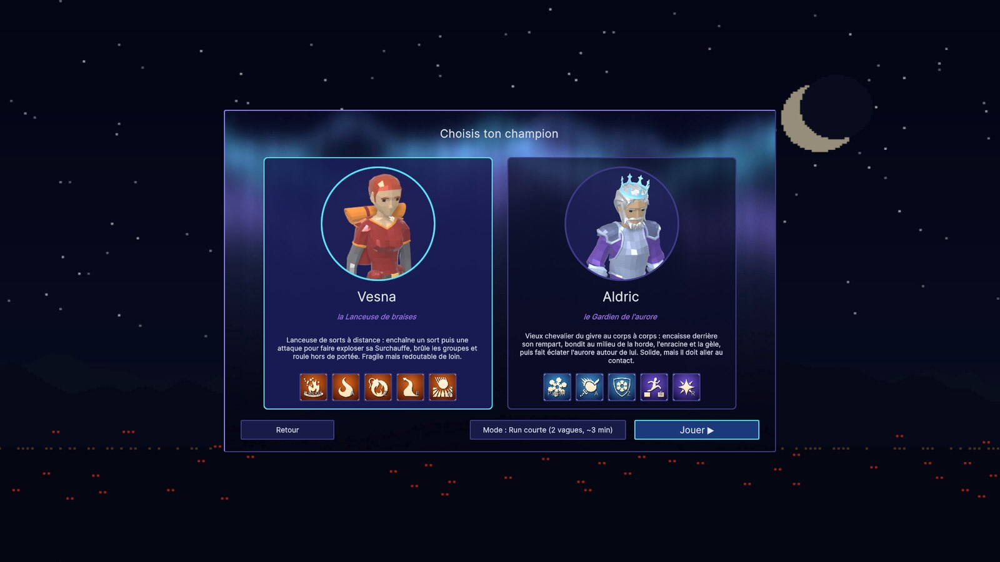
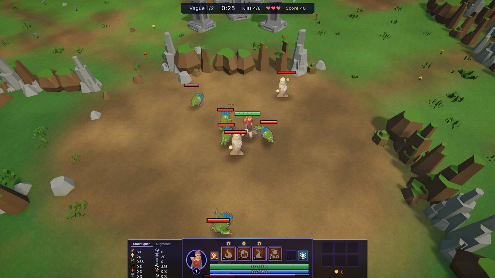
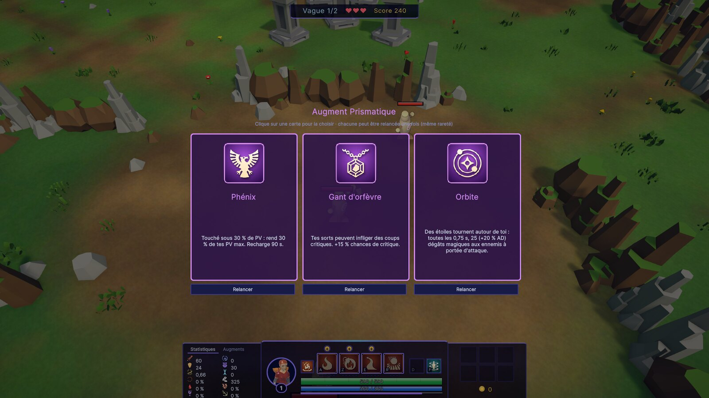
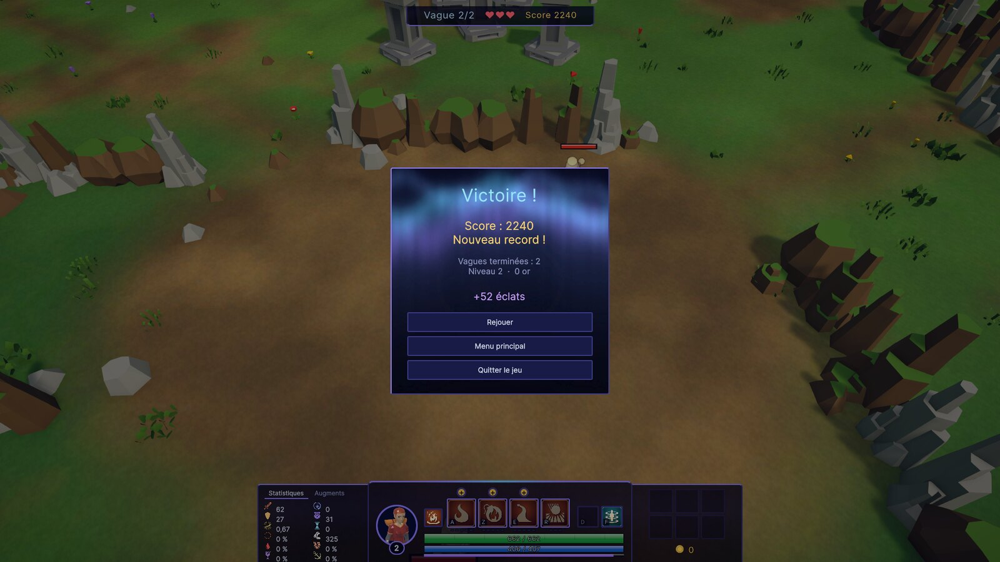
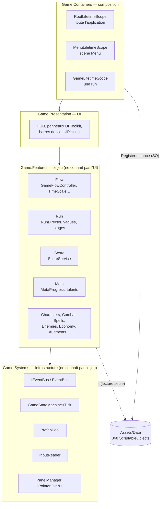
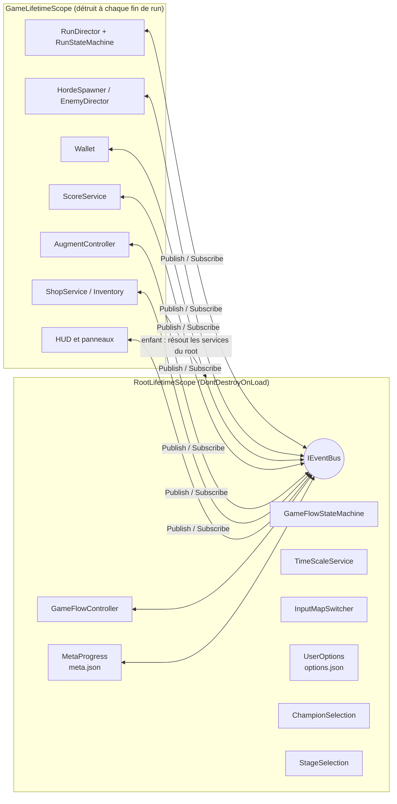
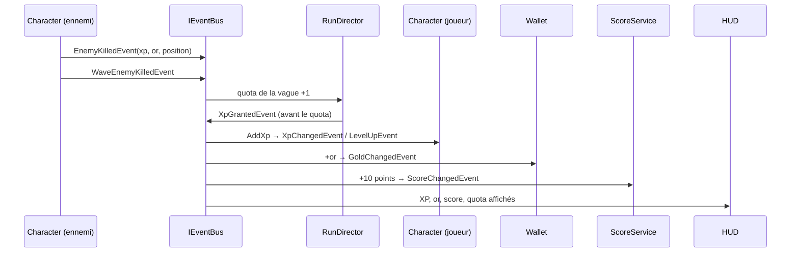
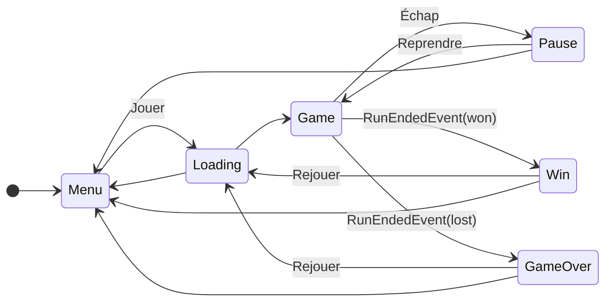

# Aegis — Document de rendu (B3 Workshop 1)

Prototype de rogue-lite à vagues d'ennemis réalisé sous **Unity 6.3 (C#)**. Le contenu sert de
prétexte : ce document explique l'architecture qui le fait tourner, ses choix et leurs limites.

| | |
|---|---|
| Dépôt | <https://github.com/Kureo524/Aegis> (branche `main`, historique de développement sur `dev`) |
| Build | page *Releases* du dépôt : `Aegis-<version>-Windows.zip`, extraire puis lancer `Aegis.exe` |
| Version PDF mise en page | [`Docs/Rendu.pdf`](Rendu.pdf) |
| Spécification détaillée | [`Docs/CharacterSystem_Design.md`](CharacterSystem_Design.md) (document de travail, ~1 300 lignes) |

## 1. La run minimale (2-3 minutes)

Menu principal → **Jouer** → choix du champion. Le bouton **Mode** affiche par défaut la
**Run courte (2 vagues, ~3 min)** ; il permet aussi de lancer la partie complète (5 vagues, un boss,
2 vagues bonus).

| Étape | Ce qui se passe | Systèmes traversés |
|---|---|---|
| Menu | `GameState.Menu`, choix du champion et du mode | machine à états, données (`StageCatalog`, `ChampionRoster`) |
| Vague 1 (40 s) | la horde arrive ; chaque kill donne XP, or et points | event bus, données (`WaveDefinition`), XP, score |
| Fin de vague 1 | **choix d'un augment** parmi 3 (jeu en pause) | `WaveRewardSchedule` (donnée), `RunStateMachine` |
| Pause (20 s max) | boutique ouverte, bouton « Lancer la vague » | |
| Vague 2 (45 s) | quota de kills, puis victoire | |
| Fin | `GameState.Win` / `GameOver` : **score final**, record, éclats gagnés | score, méta-progression (sauvegarde JSON) |
| Retour menu | les éclats sont dépensables dans l'arbre de talents (*Progression*) | méta-progression |

| | |
|---|---|
|  |  |
|  |  |

Commandes essentielles : **clic droit** pour se déplacer et attaquer, **A Z E R** (AZERTY) pour les sorts,
**Échap** pour la pause. Le tableau complet est dans le [README](../README.md).

## 2. Choix du moteur : Unity 6.3

| Critère | Unity | Unreal Engine | Godot |
|---|---|---|---|
| Données externes | **ScriptableObjects** : assets typés, éditables dans l'Inspector, référençables entre eux | DataAsset / DataTable (proches) | Resources (proches) |
| Injection de dépendances | **VContainer**, mûr et rapide, scopes par scène | pas d'équivalent standard (subsystems) | pas d'équivalent standard (autoloads = singletons) |
| Tests automatisés | **Unity Test Framework** (EditMode + PlayMode, en ligne de commande) | Automation, plus lourd | GUT (communauté) |
| Jeu 2.5D à sprites | adapté (URP, sprites en billboard) | surdimensionné | adapté |
| Itération | C# compilé en quelques secondes | C++ long à compiler, ou Blueprints difficiles à relire et à versionner | rapide |
| Build Windows depuis Linux | oui (module Windows Mono) | difficile | oui |

**Pourquoi Unity** : c'est le moteur où les quatre exigences du sujet ont l'outillage le plus direct.
Les ScriptableObjects répondent à la conception orientée données, VContainer à la gestion des
services, l'Unity Test Framework permet de vérifier l'architecture et la run. C# est aussi le
langage que l'équipe maîtrise le mieux.

**Limites assumées** : le moteur est propriétaire et sa politique de licence a déjà changé (épisode
du *runtime fee*). L'éditeur est lourd. Le *domain reload* et la sérialisation imposent des
contraintes : pas de génériques ouverts sérialisés, et les enums sont sérialisés en entiers, donc
un état ne s'ajoute qu'en fin d'enum. Les ScriptableObjects restent des assets Unity : ils ne
s'éditent pas hors de l'éditeur (un tableur, par exemple).

## 3. Architecture

### 3.1 Couches et assemblies

Le code est découpé en quatre *assembly definitions*. Chaque couche ne dépend que de celles du
dessous, et le compilateur refuse toute dépendance à rebours. Quand le gameplay a besoin d'une
information de l'UI (« le clic est-il sur le HUD ? ») ou doit piloter une vue (la barre de vie d'un
personnage), il passe par une interface déclarée en bas (`IPointerOverUi`, `ICharacterOverlay`) et
implémentée par la présentation : c'est l'inversion de dépendance.

| Dossier | Rôle | Contenu |
|---|---|---|
| `Assets/Systems` | infrastructure réutilisable | bus d'événements, machine à états générique, pool, lecture des entrées, gestion des panneaux |
| `Assets/Features/<Domaine>` | logique de jeu, un dossier par domaine | `Run`, `Score`, `Meta`, `Combat`, `Enemies`, `Economy`… et leurs définitions de données (classes SO) |
| `Assets/Features/UI` | présentation (assembly `Game.Presentation`) | HUD et panneaux (UI Toolkit) : ils lisent l'état, s'abonnent au bus et publient des *requêtes* |
| `Assets/Data` | données | les assets (vagues, ennemis, sorts, objets, augments, talents, réglages) |
| `Assets/Containers` | câblage | les trois `LifetimeScope` VContainer, seul endroit qui connaît toutes les classes |
| `Assets/Editor` | outils | génération des données (`Tools > Project Setup`), builds |
| `Assets/Tests` | qualité | 212 tests EditMode et PlayMode |

### 3.2 Scopes et services

Détruire le `GameLifetimeScope` (fin de run, « Rejouer ») remet à zéro tout l'état de la run : or,
objets, score, vagues. La méta-progression vit dans le scope racine : elle survit aux runs et ne
dépend d'aucun système de gameplay.

### 3.3 Exemple : un ennemi meurt

Le cas cité par le sujet. Aucun de ces systèmes ne référence les autres.

### 3.4 Machines à états

Un seul code de machine, `GameStateMachine<TId>` (dans `Systems`), sert deux enums :
`GameState` (ci-dessus) et `RunState` (`PreWave → Combat → Overtime → Reward`). Les règles de
transition sont des données sérialisées. Une transition interdite est refusée et journalisée. Les
réactions aux états ne sont pas dupliquées dans les états : elles sont *abonnées* au changement.
Ainsi `TimeScaleService` met le temps à 0 en `Pause`, `Win`, `GameOver` et `Reward`,
`InputMapSwitcher` change la carte d'entrées et les panneaux s'ouvrent seuls. Chaque scène déclare
son état d'entrée (`SceneEntryPoint`), ce qui permet de lancer n'importe quelle scène directement
dans l'éditeur.

## 4. Choix techniques et limites assumées

### 4.1 Event bus

`IEventBus` (`Publish<T>` / `Subscribe<T>`) est **injecté, jamais statique**. Les événements sont des
`readonly struct` (88 types) : il n'y a pas de boxing ni d'allocation à la publication. `Subscribe`
renvoie un `IDisposable` ; un composant regroupe ses abonnements dans un `DisposableBag` qu'il libère
dans `OnDestroy` ou `Dispose`. Les événements *par personnage* (coup porté, dégâts subis, pour les
passifs et les objets) passent par des `event` C# locaux. Mettre des centaines d'ennemis sur le bus
global le saturerait.

**Limites assumées** :
- Le flux est plus dur à suivre qu'un appel direct (« qui écoute cet événement ? » demande une recherche).
- L'ordre des abonnés est l'ordre d'abonnement. Un cas réel : la méta-progression reçoit le score
  avant l'écran de fin, qui doit donc accepter de recevoir le record avant le score.
- Un abonnement oublié fuit. Ce risque est limité par la convention `DisposableBag` et par les scopes,
  qui libèrent tout à la fin de la run.
- Le bus est synchrone et sans file : une publication dans un handler s'exécute immédiatement.

### 4.2 Gestion des services : injection de dépendances (VContainer)

Les services sont enregistrés dans trois scopes (§3.2). Les classes C# pures reçoivent leurs
dépendances par constructeur ; les `MonoBehaviour` par une méthode `[Inject] Construct(...)`. Le code
de jeu ne contient **aucun singleton, aucun champ `static` mutable, aucun `FindObjectOfType` ni
`Camera.main`**. Un test (`ArchitectureTests`) le vérifie par réflexion sur les assemblies compilées.

**Pourquoi pas un Singleton ou un Service Locator** : avec un singleton, chaque système est couplé à
une classe concrète et globale. On ne peut ni le remplacer dans un test ni avoir deux runs isolées.
Avec un Service Locator, les dépendances sont cachées dans le corps des méthodes. Avec l'injection,
les dépendances sont visibles dans la signature, et un test construit le système avec ce qu'il veut :
`ScoreService` se teste avec un `EventBus` neuf, sans scène. La durée de vie est donnée par le scope :
la run meurt avec sa scène.

**Limites assumées** :
- Une dépendance manquante n'apparaît qu'à l'exécution, à la construction du scope, et pas à la compilation.
- Les scopes ajoutent du code de câblage. `GameLifetimeScope` enregistre une trentaine de services,
  et c'est le seul fichier qui les connaît tous.
- La courbe d'apprentissage est réelle : injection des `MonoBehaviour`, objets instanciés à
  l'exécution via `IObjectResolver.Instantiate`, ordre des points d'entrée.

### 4.3 Conception orientée données

Les vagues (`WaveDefinition` : quota, durée, table d'apparition pondérée, multiplicateurs), les stages
(`StageDefinition`), les ennemis et boss (`EnemyDefinition`, `BossDefinition`, motifs d'attaque), les
améliorations (68 objets, 43 augments, talents) et les réglages sont des **ScriptableObjects**. Le
code ne contient aucune valeur d'équilibrage. Les ScriptableObjects sont **en lecture seule à
l'exécution** : l'état vit dans des instances runtime (`Passive`, `Spell`…). Ils sont injectés
(`RegisterInstance`), jamais cherchés par nom.

La run courte de ce rendu le montre : **c'est uniquement de la donnée**. Il s'agit d'un
`Stage_Demo` à deux vagues (copiées des deux premières vagues du stage complet, avec des durées plus
courtes) et d'un `StageCatalog` qui le propose en premier. Le barème du score est lui aussi un asset
(`ScoreRules` : 10 points par kill, 200 par vague, 500 par boss, 1 000 de bonus de victoire et 250
par vie restante).

Des scripts d'éditeur (`Tools > Project Setup`) génèrent et réparent toutes ces données de façon
idempotente. Le contenu se reconstruit donc à l'identique, et les réglages faits à la main dans les
assets ne sont pas écrasés.

**Limites assumées** :
- Les ScriptableObjects ne s'éditent que dans Unity (pas d'export tableur).
- Les références entre assets passent par des GUID : renommer est sans risque, mais un asset supprimé
  laisse une référence vide, détectée seulement par les tests ou à l'exécution.
- Les comportements vraiment nouveaux (un nouveau type d'effet de passif) demandent toujours du code ;
  seules leurs *combinaisons* sont des données.

### 4.4 Méta-progression persistante

`MetaProgress` (scope racine) écoute `RunEndedEvent` pour créditer des éclats et `RunScoredEvent`
pour garder le meilleur score. Il sauvegarde en **JSON** dans `Application.persistentDataPath/meta.json`
(sous Windows : `%USERPROFILE%\AppData\LocalLow\DefaultCompany\Aegis\meta.json`). Les éclats achètent
des talents par champion, appliqués au début de la run suivante par `MetaApplier` et
`RunModifiers` (PV, or de départ, vies, relances d'augment…). La run ne connaît pas la sauvegarde,
et la sauvegarde ne connaît pas la run : seuls des événements les relient. En éditeur et en test, le
fichier est `meta.editor.json`, ce qui protège la sauvegarde du joueur.

**Limites** : il n'y a ni versionnage du format, ni chiffrement, ni écriture atomique. Une coupure
pendant l'écriture peut corrompre le fichier ; il est alors ignoré, avec un avertissement, et la
progression repart de zéro.

### 4.5 Découplage vérifié

- **Désactiver un système** : sans l'asset `ScoreRules` dans la scène, `ScoreService` n'est pas
  enregistré. La run se joue à l'identique, le HUD masque le score et l'écran de fin n'affiche pas la
  ligne de score. Un test vérifie qu'aucune classe ne dépend de `ScoreService`.
- **Couches** : un test vérifie que `Game.Systems` ne référence ni le jeu ni les scopes, et que le jeu
  ne référence ni l'UI (`Game.Presentation`) ni les scopes.
- **Tests** : 212 tests au total. En EditMode : stats, dégâts, machine à états, bus, boutique,
  augments, méta, score, architecture. En PlayMode, dans la vraie scène : vagues, victoire, défaite,
  boss, run courte complète jusqu'à la sauvegarde. S'y ajoute un bot d'équilibrage qui joue la partie
  entière (`[Explicit]`).

## 5. Limites connues et pistes avec plus de temps

| Limite | Ce qu'on ferait |
|---|---|
| Certains panneaux lisent directement des services concrets du gameplay (`ShopPanel` → `ShopService`, `MetaPanel` → `MetaProgress`). C'est autorisé (la présentation est au-dessus), mais remplacer un service oblige à toucher son panneau | des interfaces en lecture seule (`IShopQuery`, `IMetaQuery`) entre les deux couches |
| Quelques classes trop grosses : `ShopPanel` (700 lignes), `PlayerHud` (440 lignes) | les découper en vues (onglets, info-bulles, grille) |
| `Game.Features` est une seule assembly | une assembly par domaine pour forcer le découplage à la compilation |
| Sauvegarde JSON simple | format versionné, écriture atomique (fichier temporaire puis renommage), plusieurs emplacements |
| Bus synchrone sans outil de diagnostic | une fenêtre de debug listant les abonnés et les derniers événements publiés |
| Audio absent, effets visuels minimaux | un `AudioService` abonné au bus, sans toucher au gameplay |
| Le contenu dérive d'une spécification MOBA (sorts à rangs, objets) plus riche que le sujet | c'est un choix de motivation ; l'architecture n'en dépend pas, comme le montre la run courte |

## 6. Versionnement

- Branches : `feature/<module>-<sujet>` → PR vers `dev` → `main` aux jalons (tags `v0.1`, `v0.2`, `v0.3`…).
- Commits atomiques au format *Conventional Commits*, en français (`feat(run): …`, `test: …`, `docs: …`).
- Dépôt rendu public avec un historique nettoyé des ressources tierces (les visuels sont originaux ou
  sous licence CC0 / CC BY, voir le README).
- `.gitignore` Unity : `Library/`, `Builds/`, fichiers d'IDE. Les données et les scènes sont en texte (*Force Text*).
